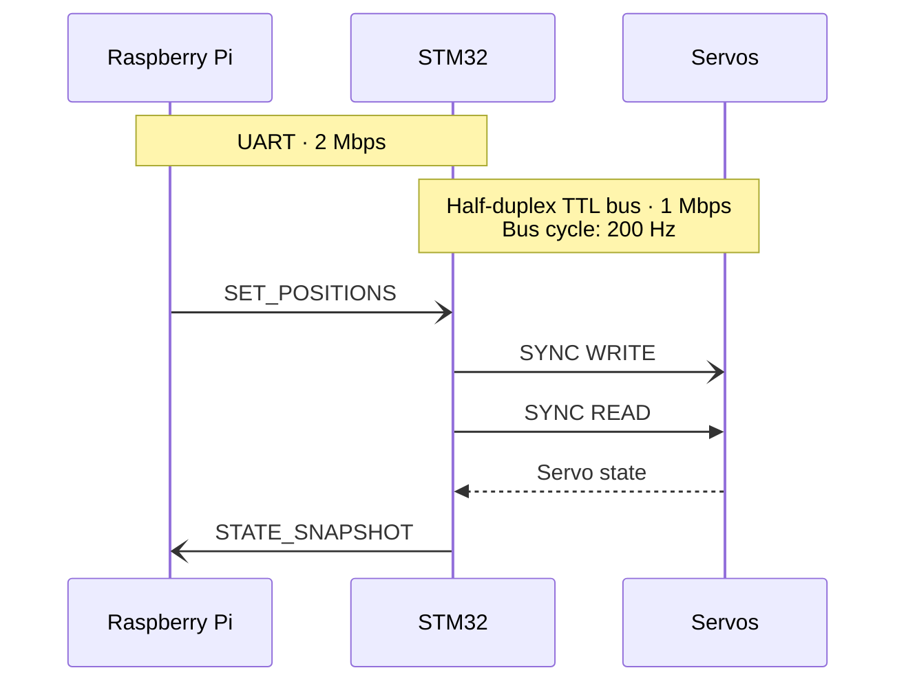

The Raspberry Pi and the motherboard's STM32 communicate over a **2 Mbps** UART link, using a custom frame protocol: the **bridge** *(I would have liked to call it chromaping, though...)*.

The reference implementation lives in [`bridge.h`](https://github.com/Mowibox/chromapi_motherboard/blob/main/firmware/chromapi_stm32_core/Core/Inc/bridge.h) & [`bridge.c`](https://github.com/Mowibox/chromapi_motherboard/blob/main/firmware/chromapi_stm32_core/Core/Src/bridge.c) on the firmware side, and
[`motherboard_bridge.py`](https://github.com/Mowibox/chromapi/blob/main/src/chromapi/hardware/motherboard_bridge.py)
on the Python side.

## Overview

Two flows share the same link:

* **The state stream**: at the end of each servo bus cycle (at 200 Hz), the STM32 sends a snapshot of the robot's state ([`STATE_SNAPSHOT`](#state_snapshot)) to the Raspberry Pi on its own.
* **Commands**: the Raspberry Pi sends a frame, and the STM32 replies to it (or not, depending on the command received).

## Frame format

Instruction frames and returned frames share the same format:

| | SYNC_1 | SYNC_2 | LENGTH | CMD | PAYLOAD | CRC_L | CRC_H |
| :--- | :--- | :--- | :--- | :--- | :--- | :--- | :--- |
| **Value** | `0x55` | `0xAA` | `N + 1` | Code | Data | CRC, low byte | CRC, high byte |
| **Size** | 1 byte | 1 byte | 1 byte | 1 byte | N bytes | 1 byte | 1 byte |

* **SYNC_1 / SYNC_2 (header)**: the sync bytes `0x55 0xAA` mark the start of a frame.
* **LENGTH**: the number of bytes in CMD and PAYLOAD, i.e. `len(payload) + 1`. A zero length is invalid.
* **CMD**: the [command](#instruction-types) code in an instruction frame, or the [response](#response-types) code in a returned frame.
* **PAYLOAD**: the command-specific data, 0 bytes or more.
* **CRC**: CRC-16 over the bytes from LENGTH to the end of PAYLOAD. It is sent low byte first.

A frame is therefore `N + 6` bytes long. The firmware rejects incoming frames longer than 64 bytes. All multi-byte fields are [little-endian](https://en.wikipedia.org/wiki/Endianness).

### CRC

The Cyclic Redundancy Check (CRC) is a value computed from the bytes of the frame. The sender appends it to the frame, and the receiver computes it again: if the two values differ, the frame was corrupted in transit, so it is ignored.

The computation amounts to dividing the frame's bytes by a fixed number, the polynomial: the CRC is the remainder of that division. This protocol uses the [CRC-16/CCITT-FALSE](https://reveng.sourceforge.io/crc-catalogue/16.htm) variant:

| Parameter | Value | Meaning |
| :--- | :--- | :--- |
| Size | 16 bits | The CRC fits in 2 bytes (`CRC_L` and `CRC_H`) |
| Polynomial | `0x1021` | The divisor, i.e. x¹⁶ + x¹² + x⁵ + 1 |
| Initial value | `0xFFFF` | The computation starts with all bits set to 1, so that `0x00` bytes at the start of the frame change the result |

**Example**: `PING_BRIDGE` (`0x01`), no payload. The CRC is computed over `01 01` (the length, then the command) and equals `0x3E1F`.

*Instruction frame:* `55 AA 01 01 1F 3E`

| Sync | Length | CMD | CRC |
| :--- | :--- | :--- | :--- |
| `0x55 0xAA` | `0x01` | `0x01` (`PING_BRIDGE`) | `0x1F 0x3E` |

*Returned data frame:* `55 AA 01 80 B6 BF`. The STM32 acknowledges with `OK`; the CRC `0xBFB6` is computed over `01 80`.

| Sync | Length | CMD | CRC |
| :--- | :--- | :--- | :--- |
| `0x55 0xAA` | `0x01` | `0x80` (`OK`) | `0xB6 0xBF` |

## Instruction types

| Code | Command | Payload | Response |
| :--- | :--- | :--- | :--- |
| `0x01` | `PING_BRIDGE` | — | `OK` |
| `0x02` | `SET_POSITIONS` | Target positions of the 12 servos | None (`ERROR` if the payload is too short) |
| `0x03` | `SET_TORQUE` | Servo mask, torque states | None (`ERROR` if the payload is too short) |
| `0x04` | `PING_SERVO` | Servo ID | `OK` / `ERROR` |
| `0x06` | `SET_SERVO_ID` | Current ID, new ID | `OK` / `ERROR` |
| `0x07` | `SET_LED_COLOR` | Target, (LED index), R, G, B triplet | `OK` / `ERROR` |
| `0x08` | `SET_LED_RING_BULK` | R, G, B triplet of the 18 LEDs | `OK` / `ERROR` |
| `0x0A` | `WRITE_SERVO_REGISTER` | ID, register, size, value | `OK` / `ERROR` |
| `0x0B` | `READ_SERVO_REGISTER` | ID, register, size | `SERVO_REG_VALUE` / `ERROR` |
| `0x0C` | `GET_VERSION` | — | `VERSION` |

An unknown command code receives `ERROR`.

`SET_POSITIONS` and `SET_TORQUE` are not acknowledged: they are sent on every tick of the control loop, and their effect shows up in the next `STATE_SNAPSHOT`. The setpoints are queued and go out on the bus at the start of the next cycle.

`PING_SERVO`, `SET_SERVO_ID`, `WRITE_SERVO_REGISTER` and `READ_SERVO_REGISTER` are relayed onto the [servo bus](#servo-bus-protocol). They wait for the current cycle to finish and can take up to about 225 ms.

## Response types

| Code | Name | Meaning |
| :--- | :--- | :--- |
| `0x80` | `OK` | Command acknowledged |
| `0x81` | `ERROR` | Unknown, malformed or failed command. Empty payload |
| `0x83` | `STATE_SNAPSHOT` | Robot state, sent on every bus cycle |
| `0x84` | `SERVO_REG_VALUE` | Reply to `READ_SERVO_REGISTER`: the register value |
| `0x85` | `VERSION` | Reply to `GET_VERSION`: protocol and firmware versions |

## Payload structures

**`SET_POSITIONS`** (`0x02`): 24 bytes.

| Field | Type | Notes |
| :--- | :--- | :--- |
| `positions[12]` | `uint16` | Raw target position in steps (0 to 4095), in order of IDs 1 to 12 |

**`SET_TORQUE`** (`0x03`): 4 bytes.

| Field | Type | Notes |
| :--- | :--- | :--- |
| `mask` | `uint16` | Servos affected: bit `i` stands for ID `i + 1` |
| `on` | `uint16` | Desired state for each: bit set, torque enabled; bit clear, torque released |

**`SET_LED_COLOR`** (`0x07`):

| Target | Payload | Notes |
| :--- | :--- | :--- |
| `0x01` `LED_RING_ALL` | `0x01 R G B` | All LEDs take the same color |
| `0x02` `LED_RING_SINGLE` | `0x02 index R G B` | A single LED, index 0 to 17 |

**`SET_LED_RING_BULK`** (`0x08`): 54 bytes, 18 × (`R`, `G`, `B`).

**`SET_SERVO_ID`** (`0x06`): 2 bytes, the current ID then the new ID.

**`WRITE_SERVO_REGISTER`** (`0x0A`): 5 bytes.

| Field | Type | Notes |
| :--- | :--- | :--- |
| `servo_id` | `uint8` | Target servo |
| `register` | `uint8` | Address in the control table |
| `size` | `uint8` | `1` or `2` |
| `value` | `uint16` | Always 2 bytes; the high byte is ignored if `size` is 1 |

**`READ_SERVO_REGISTER`** (`0x0B`): 3 bytes (`servo_id`, `register`, `size`). The `SERVO_REG_VALUE` (`0x84`) reply contains `size` bytes.

**`VERSION`** (`0x85`): 4 bytes.

| Field | Type | Notes |
| :--- | :--- | :--- |
| `protocol` | `uint8` | Bridge protocol version (`2`) |
| `major`, `minor`, `patch` | `uint8` × 3 | Firmware version |

**Example**: `GET_VERSION` (`0x0C`) with firmware 2.0.0.

*Instruction frame:* `55 AA 01 0C B2 EF`

*Returned data frame:* `55 AA 05 85 02 02 00 00 9E CF`

| Sync | Length | CMD | Payload | CRC |
| :--- | :--- | :--- | :--- | :--- |
| `0x55 0xAA` | `0x05` | `0x85` (`VERSION`) | `0x02` (protocol 2), `0x02 0x00 0x00` (firmware 2.0.0) | `0x9E 0xCF` |

Firmware older than 2.0.0 does not know this command. If the protocol version does not match the SDK's, `chromapi version` and `chromapi health` report it: one of the two needs to be updated.

### STATE_SNAPSHOT

`STATE_SNAPSHOT` (`0x83`) is 168 bytes:

| Field | Type | Notes |
| :--- | :--- | :--- |
| `seq` | `uint8` | +1 on every cycle. A gap on the Raspberry Pi side means a lost frame |
| `t_us` | `uint32` | STM32 time at the end of the servo read, in µs *(wraps around about every 71 min)* |
| `cycle_us` | `uint16` | Bus cycle duration, write and read, in µs |
| `bus_uV` | `int32` | Bus voltage, in µV |
| `current_uA` | `int32` | Current draw, in µA |
| `power_uW` | `int32` | Power, in µW |
| `servos[12]` | 12 × 10 bytes | *See below* |
| `imu_acc[3]` | `int16` | Accelerometer, in m/s² × 100 |
| `imu_gyro[3]` | `int16` | Raw gyroscope, in rad/s × 1000 |
| `imu_gyro_corr[3]` | `int16` | Gyroscope with bias corrected by the Mahony filter, in rad/s × 1000 |
| `imu_quat[4]` | `int16` | Orientation quaternion (w, x, y, z) × 32767 |
| `switches_mask` | `uint8` | Foot switches: bit 0 `TL`, bit 1 `TR`, bit 2 `BL`, bit 3 `BR` |
| `servo_fresh_mask` | `uint16` | Bit `i` set means the servo with ID `i + 1` replied during this cycle |

If a servo did not reply during the cycle, its `servo_fresh_mask` bit is 0 and its values are those of a previous cycle. The power measurement is refreshed at 10 Hz.

Each entry of `servos[12]`, in order of IDs 1 to 12:

| Field | Type | Notes |
| :--- | :--- | :--- |
| `position` | `uint16` | Position in steps (0 to 4095) |
| `speed` | `int16` | Speed, in steps/s |
| `load` | `int16` | Load, in 0.1% of rated torque |
| `temperature` | `uint8` | Temperature, in °C |
| `voltage` | `uint8` | Voltage, in 0.1 V |
| `current` | `int16` | Current, in units of 6.5 mA |

## Error handling

* **Invalid CRC**: the frame is ignored on both sides, and the receiver resynchronizes on the next `0x55 0xAA` bytes.
* **`ERROR` (`0x81`)**: the STM32 received a valid frame but could not execute it: unknown command, payload too short, LED index out of range or servo not responding.
* **Timeout**: on the SDK side, a command with no reply after one second fails. Reading the state gives up after 50 ms without a `STATE_SNAPSHOT`.
* **Link loss**: with no valid frame from the Raspberry Pi for 60 seconds, the STM32 drops the queued setpoints and releases the torque of all 12 servos. During a shorter silence, each servo keeps its last setpoint.

## Servo bus protocol

Between the STM32 and the servos, the **Feetech STS3215** protocol is used, on a 1 Mbps half-duplex TTL bus (see [actuators]()). It works as question and answer: the STM32 sends an instruction packet, and only the servo with the matching ID replies. Full details are in the [protocol manual](https://github.com/Mowibox/stm32-sts3215-lib/blob/main/docs/protocol_manual.md) and the [STS3215 memory table](https://github.com/Mowibox/stm32-sts3215-lib/blob/main/docs/sts3215_memory_table.md) of the [stm32-sts3215-lib](https://github.com/Mowibox/stm32-sts3215-lib) library.

### Instruction packet

| Header | ID | Length | Instruction | Parameters | Checksum |
| :--- | :--- | :--- | :--- | :--- | :--- |
| `0xFF 0xFF` | `ID` | `N + 2` | `Instruction` | `Param_1 ... Param_N` | `Checksum` |

* **Header**: two consecutive `0xFF` mark the start of a packet.
* **ID**: the servo address, from `0x00` to `0xFD`. ID `0xFE` addresses every servo on the bus (broadcast): none of them replies, except to a `PING`.
* **Length**: the number of parameters `N`, plus 2 (instruction and checksum).
* **Checksum**: `~(ID + Length + Instruction + Param_1 + ... + Param_N) & 0xFF`. Its format and computation differ from the bridge CRC.

Two-byte values are sent low byte first.

### Reply packet

| Header | ID | Length | Status | Parameters | Checksum |
| :--- | :--- | :--- | :--- | :--- | :--- |
| `0xFF 0xFF` | `ID` | `N + 2` | `Status` | `Param_1 ... Param_N` | `Checksum` |

* **Status**: `0x00` if all is well. Otherwise, each bit flags a servo error (voltage, temperature, overload...).
* **Parameters**: the data read, for a read instruction. Empty otherwise.

### Instructions

| Code | Instruction | Purpose | Used by Chromapi |
| :--- | :--- | :--- | :--- |
| `0x01` | `PING` | Check that a servo responds | `PING_SERVO`, servo detection at startup |
| `0x02` | `READ DATA` | Read from the memory table | `READ_SERVO_REGISTER` |
| `0x03` | `WRITE DATA` | Write to the memory table, taking effect immediately | `WRITE_SERVO_REGISTER`, `SET_SERVO_ID` |
| `0x04` | `REG WRITE` | Write without applying, until the next `ACTION` | — |
| `0x05` | `ACTION` | Apply pending `REG WRITE`s | — |
| `0x06` | `RESET` | Restore factory settings | — |
| `0x82` | `SYNC READ` | Read the same area from several servos in one request | Reading the state of the 12 servos, every cycle |
| `0x83` | `SYNC WRITE` | Write the same area to several servos in one packet | `SET_POSITIONS`, `SET_TORQUE` |

### Registers used

Excerpt from the [memory table](https://github.com/Mowibox/stm32-sts3215-lib/blob/main/docs/sts3215_memory_table.md): only the registers Chromapi reads or writes are listed. EEPROM registers are kept when powered off, provided the lock (`0x37`) was opened before writing them.

| Address | Register | Bytes | Area | Use |
| :--- | :--- | :--- | :--- | :--- |
| `0x05` | ID | 1 | EEPROM | Bus identifier, from 1 to 12 |
| `0x0E` | Maximum voltage | 1 | EEPROM | 85, i.e. 8.5 V |
| `0x0F` | Minimum voltage | 1 | EEPROM | 60, i.e. 6.0 V |
| `0x13` | Unloading conditions | 1 | EEPROM | 44: protections enabled |
| `0x15` / `0x16` / `0x17` | P, D, I coefficients | 1 each | EEPROM | 32, 0, 0 |
| `0x21` | Operating mode | 1 | EEPROM | 0: position control |
| `0x28` | Torque | 1 | SRAM | 0: released, 1: enabled, 128: the current position becomes the center (2048) |
| `0x29` | Acceleration | 1 | SRAM | 0: no limit |
| `0x2A` | Target position | 2 | SRAM | Written every cycle by `SYNC WRITE` |
| `0x37` | EEPROM lock | 1 | SRAM | 0: open, EEPROM writes are kept; 1: closed |
| `0x38` to `0x46` | Feedback | 15 | SRAM | Read every cycle by `SYNC READ`: position (`0x38`), speed (`0x3A`), load (`0x3C`), voltage (`0x3E`), temperature (`0x3F`), current (`0x45`) |

The first start also writes the undocumented register `0x55` (acceleration limit of the internal motion profile) to 254.

### Changing the ID

A servo leaves the factory with ID 1, but a reused servo can have any ID. The SDK therefore addresses it by broadcast (`0xFE`). Example to give it ID 5:

| Step | Frame | Meaning |
| :--- | :--- | :--- |
| 1 | `FF FF FE 04 03 37 00 C3` | Open the EEPROM lock (`0x37` = 0) |
| 2 | `FF FF FE 04 03 05 05 F0` | Write the new ID (`0x05` = 5) |
| 3 | `FF FF 05 04 03 37 01 BB` | Close the lock, this time at the new ID 5's address |

Every servo on the bus receives these broadcast frames and would take the same ID. That is why new servos are set up [one at a time](), with a single servo plugged in.

## Full example: from the Raspberry Pi to the servo

The Raspberry Pi sends `READ_SERVO_REGISTER(servo_id=1, register=0x38, size=2)` to read the position of servo 1. The STM32 relays the request onto the servo bus, then returns the value read:

| Hop | Frame | Meaning |
| :--- | :--- | :--- |
| RPi → STM32 | `55 AA 04 0B 01 38 02 5B 1D` | `READ_SERVO_REGISTER(id=1, reg=0x38, size=2)` |
| STM32 → Servo 1 | `FF FF 01 04 02 38 02 BE` | `READ DATA`, register `0x38`, 2 bytes |
| Servo 1 → STM32 | `FF FF 01 04 00 18 05 DD` | No error, position `0x0518` (1304) |
| STM32 → RPi | `55 AA 03 84 18 05 F9 22` | `SERVO_REG_VALUE` = 1304 |
