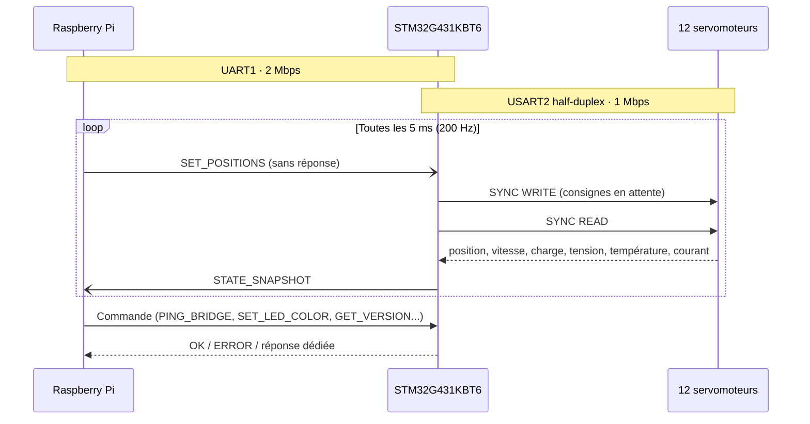

Le Raspberry Pi et le STM32 de la carte mère communiquent par une liaison UART à **2 Mbps**, avec un protocole de trames personnalisé : le *bridge*. Cette page décrit la **version 2** du protocole, celle du firmware 2.0.0.

L'implémentation de référence se trouve dans [`bridge.h`](https://github.com/Mowibox/chromapi_motherboard/blob/main/firmware/chromapi_stm32_core/Core/Inc/bridge.h) et [`bridge.c`](https://github.com/Mowibox/chromapi_motherboard/blob/main/firmware/chromapi_stm32_core/Core/Src/bridge.c) côté firmware, et dans [`motherboard_bridge.py`](https://github.com/Mowibox/chromapi/blob/main/src/chromapi/hardware/motherboard_bridge.py) côté Python.

## Vue d'ensemble

Deux flux circulent sur la même liaison :

* **Le flux d'état** : à la fin de chaque cycle du bus des servomoteurs (200 Hz), le STM32 envoie de lui-même un `STATE_SNAPSHOT` au Raspberry Pi, sans qu'on le lui demande.
* **Les commandes** : le Raspberry Pi envoie une trame, et le STM32 y répond (ou non, selon la commande).



## Format de trame

Les requêtes et les réponses ont le même format :

```text
[ SYNC_1 ][ SYNC_2 ][ LONGUEUR ][ CMD ][ PAYLOAD... ][ CRC_L ][ CRC_H ]
   0x55      0xAA       N+1      1 o.     N octets     1 o.     1 o.
```

* **SYNC_1 / SYNC_2** : octets de synchronisation fixes `0x55 0xAA`, qui repèrent le début d'une trame.
* **LONGUEUR** : nombre d'octets de CMD et du PAYLOAD, soit `len(payload) + 1`. Une longueur nulle est invalide.
* **CMD** : le code de [commande](#commandes) dans une requête, ou le code de [réponse](#réponses) dans une réponse.
* **PAYLOAD** : les données propres à la commande, 0 octet ou plus.
* **CRC** : CRC-16 sur les octets de LONGUEUR jusqu'à la fin du PAYLOAD, transmis octet faible d'abord.

Une trame fait donc `N + 6` octets. Le firmware refuse les trames entrantes de plus de 64 octets. Tous les champs multi-octets sont en [little-endian](https://fr.wikipedia.org/wiki/Boutisme).

### CRC

Le CRC est un CRC-16/CCITT-FALSE : polynôme `0x1021`, valeur initiale `0xFFFF`, sans réflexion. En Python, c'est `binascii.crc_hqx(data, 0xFFFF)`.

**Exemple** : `PING_BRIDGE` (`0x01`), sans payload. Le CRC se calcule sur `01 01` et vaut `0x3E1F` :

```text
55 AA 01 01 1F 3E
```

Le STM32 acquitte avec `OK` (`0x80`), CRC `0xBFB6` sur `01 80` :

```text
55 AA 01 80 B6 BF
```

## Commandes

| Code | Commande | Payload | Réponse |
| :--- | :--- | :--- | :--- |
| `0x01` | `PING_BRIDGE` | — | `OK` |
| `0x02` | `SET_POSITIONS` | Positions cibles des 12 servomoteurs | Aucune (`ERROR` si le payload est trop court) |
| `0x03` | `SET_TORQUE` | Masque des servomoteurs, états du couple | Aucune (`ERROR` si le payload est trop court) |
| `0x04` | `PING_SERVO` | ID du servomoteur | `OK` / `ERROR` |
| `0x06` | `SET_SERVO_ID` | ID actuel, nouvel ID | `OK` / `ERROR` |
| `0x07` | `SET_LED_COLOR` | Cible, (index), R, G, B | `OK` / `ERROR` |
| `0x08` | `SET_LED_RING_BULK` | R, G, B des 18 LEDs | `OK` / `ERROR` |
| `0x0A` | `WRITE_SERVO_REGISTER` | ID, registre, taille, valeur | `OK` / `ERROR` |
| `0x0B` | `READ_SERVO_REGISTER` | ID, registre, taille | `SERVO_REG_VALUE` / `ERROR` |
| `0x0C` | `GET_VERSION` | — | `VERSION` |

Un code de commande inconnu reçoit `ERROR`.

`SET_POSITIONS` et `SET_TORQUE` ne sont pas acquittées : elles sont envoyées à chaque tick de la boucle de contrôle, et leur effet se lit dans le `STATE_SNAPSHOT` suivant. Les consignes sont mises en attente et partent sur le bus au début du cycle suivant.

`PING_SERVO`, `SET_SERVO_ID`, `WRITE_SERVO_REGISTER` et `READ_SERVO_REGISTER` sont relayées sur le [bus des servomoteurs](#protocole-du-bus-servo). Elles attendent que le cycle en cours se termine et peuvent prendre jusqu'à environ 225 ms.

## Réponses

| Code | Nom | Signification |
| :--- | :--- | :--- |
| `0x80` | `OK` | Commande acquittée |
| `0x81` | `ERROR` | Commande inconnue, mal formée ou échouée. Payload vide |
| `0x83` | `STATE_SNAPSHOT` | État du robot, envoyé à chaque cycle du bus |
| `0x84` | `SERVO_REG_VALUE` | Réponse à `READ_SERVO_REGISTER` : la valeur du registre |
| `0x85` | `VERSION` | Réponse à `GET_VERSION` : versions du protocole et du firmware |

## Structures des payloads

**`SET_POSITIONS`** (`0x02`) : 24 octets.

| Champ | Type | Notes |
| :--- | :--- | :--- |
| `positions[12]` | `uint16` | Position cible brute en pas (0 à 4095), dans l'ordre des ID 1 à 12 |

**`SET_TORQUE`** (`0x03`) : 4 octets.

| Champ | Type | Notes |
| :--- | :--- | :--- |
| `mask` | `uint16` | Servomoteurs concernés : le bit `i` désigne l'ID `i + 1` |
| `on` | `uint16` | État voulu pour chacun : bit à 1, couple activé ; bit à 0, couple relâché |

**`SET_LED_COLOR`** (`0x07`) :

| Cible | Payload | Notes |
| :--- | :--- | :--- |
| `0x01` `LED_RING_ALL` | `0x01 R G B` | Toutes les LEDs prennent la même couleur |
| `0x02` `LED_RING_SINGLE` | `0x02 index R G B` | Une seule LED, d'index 0 à 17 |

**`SET_LED_RING_BULK`** (`0x08`) : 54 octets, 18 × (`R`, `G`, `B`).

**`SET_SERVO_ID`** (`0x06`) : 2 octets, l'ID actuel puis le nouvel ID.

**`WRITE_SERVO_REGISTER`** (`0x0A`) : 5 octets.

| Champ | Type | Notes |
| :--- | :--- | :--- |
| `servo_id` | `uint8` | Servomoteur cible |
| `register` | `uint8` | Adresse dans la table de contrôle |
| `size` | `uint8` | `1` ou `2` |
| `value` | `uint16` | Toujours sur 2 octets ; l'octet fort est ignoré si `size` vaut 1 |

**`READ_SERVO_REGISTER`** (`0x0B`) : 3 octets (`servo_id`, `register`, `size`). La réponse `SERVO_REG_VALUE` (`0x84`) contient `size` octets.

**`VERSION`** (`0x85`) : 4 octets.

| Champ | Type | Notes |
| :--- | :--- | :--- |
| `protocol` | `uint8` | Version du protocole de bridge (`2`) |
| `major`, `minor`, `patch` | `uint8` × 3 | Version du firmware |

Exemple avec un firmware 2.0.0 :

```text
Requête : 55 AA 01 0C B2 EF
Réponse : 55 AA 05 85 02 02 00 00 9E CF
```

Un firmware antérieur à 2.0.0 ne connaît pas cette commande. Si la version du protocole n'est pas celle du SDK, `chromapi version` et `chromapi health` le signalent : il faut mettre l'un des deux à jour.

### STATE_SNAPSHOT

`STATE_SNAPSHOT` (`0x83`) fait 168 octets :

| Champ | Type | Notes |
| :--- | :--- | :--- |
| `seq` | `uint8` | +1 à chaque cycle. Un saut côté Raspberry Pi indique une trame perdue |
| `t_us` | `uint32` | Heure du STM32 à la fin de la lecture des servomoteurs, en µs (reboucle toutes les 71 min environ) |
| `cycle_us` | `uint16` | Durée du cycle du bus, écriture et lecture, en µs |
| `bus_uV` | `int32` | Tension du bus, en µV |
| `current_uA` | `int32` | Courant consommé, en µA |
| `power_uW` | `int32` | Puissance, en µW |
| `servos[12]` | 12 × 10 octets | Voir ci-dessous |
| `imu_acc[3]` | `int16` | Accéléromètre, en m/s² × 100 |
| `imu_gyro[3]` | `int16` | Gyroscope brut, en rad/s × 1000 |
| `imu_gyro_corr[3]` | `int16` | Gyroscope corrigé de son biais par le filtre de Mahony, en rad/s × 1000 |
| `imu_quat[4]` | `int16` | Quaternion d'orientation (w, x, y, z) × 32767 |
| `switches_mask` | `uint8` | Contacteurs de pied : bit 0 `TL`, bit 1 `TR`, bit 2 `BL`, bit 3 `BR` |
| `servo_fresh_mask` | `uint16` | Bit `i` à 1 : le servomoteur d'ID `i + 1` a répondu pendant ce cycle |

Chaque entrée de `servos[12]`, dans l'ordre des ID 1 à 12 :

| Champ | Type | Notes |
| :--- | :--- | :--- |
| `position` | `uint16` | Position en pas (0 à 4095) |
| `speed` | `int16` | Vitesse, en pas/s |
| `load` | `int16` | Charge, en 0,1 % du couple nominal |
| `temperature` | `uint8` | Température, en °C |
| `voltage` | `uint8` | Tension, en 0,1 V |
| `current` | `int16` | Courant, par unité de 6,5 mA |

Si un servomoteur n'a pas répondu pendant le cycle, son bit de `servo_fresh_mask` est à 0 et ses valeurs sont celles d'un cycle précédent. La mesure de puissance est rafraîchie à 10 Hz.

## Gestion des erreurs

* **CRC invalide** : la trame est ignorée des deux côtés, et le récepteur se resynchronise sur les prochains octets `0x55 0xAA`.
* **`ERROR` (`0x81`)** : le STM32 a reçu une trame valide mais n'a pas pu l'exécuter : commande inconnue, payload trop court, index de LED hors limites ou servomoteur qui ne répond pas.
* **Délai dépassé** : côté SDK, une commande sans réponse au bout d'une seconde échoue. La lecture de l'état abandonne après 50 ms sans `STATE_SNAPSHOT`.
* **Perte de liaison** : sans trame valide du Raspberry Pi pendant 60 secondes, le STM32 abandonne les consignes en attente et relâche le couple des 12 servomoteurs. Pendant un silence plus court, chaque servomoteur garde sa dernière consigne.

## Protocole du bus servo

Entre le STM32 et les servomoteurs, c'est le protocole **Feetech STS3215** qui est utilisé, sur un bus TTL half-duplex à 1 Mbps (voir les [actionneurs]()). Son format de trame et sa somme de contrôle sont différents de ceux du bridge :

```text
[ 0xFF ][ 0xFF ][ ID ][ LONGUEUR ][ INSTRUCTION ][ PARAMS... ][ CHECKSUM ]
```

* **ID** : l'adresse du servomoteur (`0x00` à `0xFD`), ou `0xFE` pour s'adresser à tous. Une trame diffusée ne reçoit pas de réponse.
* **LONGUEUR** : `N + 2`, où `N` est le nombre de paramètres.
* **CHECKSUM** : `~(ID + LONGUEUR + INSTRUCTION + PARAM_1 + ... + PARAM_N) & 0xFF`.
* Les valeurs sur deux octets sont transmises octet faible d'abord.

Le firmware utilise ces instructions :

| Code | Instruction | Utilisée par |
| :--- | :--- | :--- |
| `0x01` | `PING` | `PING_SERVO`, détection des servomoteurs au démarrage |
| `0x02` | `READ DATA` | `READ_SERVO_REGISTER` |
| `0x03` | `WRITE DATA` | `WRITE_SERVO_REGISTER`, `SET_SERVO_ID` |
| `0x82` | `SYNC READ` | Lecture de l'état des 12 servomoteurs, à chaque cycle |
| `0x83` | `SYNC WRITE` | `SET_POSITIONS`, `SET_TORQUE` |

**Aller-retour complet** : `READ_SERVO_REGISTER(servo_id=1, register=0x38, size=2)`, qui lit la position du servomoteur 1.

| Saut | Trame | Signification |
| :--- | :--- | :--- |
| RPi → STM32 | `55 AA 04 0B 01 38 02 5B 1D` | `READ_SERVO_REGISTER(id=1, reg=0x38, size=2)` |
| STM32 → Servo 1 | `FF FF 01 04 02 38 02 BE` | `READ DATA`, registre `0x38`, 2 octets |
| Servo 1 → STM32 | `FF FF 01 04 00 18 05 DD` | Pas d'erreur, position `0x0518` (1304) |
| STM32 → RPi | `55 AA 03 84 18 05 F9 22` | `SERVO_REG_VALUE` = 1304 |

Un changement d'ID s'adresse toujours à un seul servomoteur, jamais en diffusion : sinon tous les servomoteurs du bus prendraient le même identifiant. C'est pour cela que les servomoteurs neufs se configurent [un par un]().
