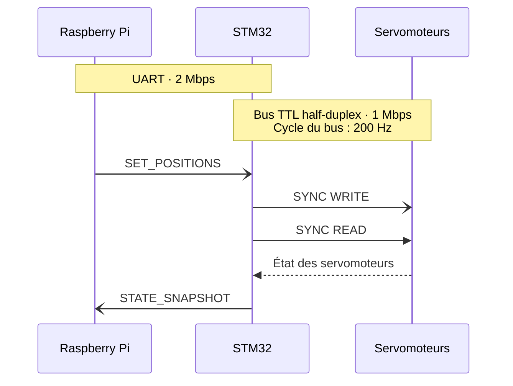

Le Raspberry Pi et le STM32 de la carte mère communiquent via une liaison UART à **2 Mbps**, avec un protocole de trames personnalisé : le **bridge** *(j'aurais bien appelé ça chromaping, tiens...)*.

L'implémentation de référence se trouve dans les fichiers [`bridge.h`](https://github.com/Mowibox/chromapi_motherboard/blob/main/firmware/chromapi_stm32_core/Core/Inc/bridge.h) & [`bridge.c`](https://github.com/Mowibox/chromapi_motherboard/blob/main/firmware/chromapi_stm32_core/Core/Src/bridge.c) côté firmware, et
[`motherboard_bridge.py`](https://github.com/Mowibox/chromapi/blob/main/src/chromapi/hardware/motherboard_bridge.py)
côté Python.

## Vue d'ensemble

Deux flux circulent sur la même liaison :

* **Le flux d'état** : à la fin de chaque cycle du bus des servomoteurs (à 200 Hz), le STM32 envoie de lui-même un état instantané du robot ([`STATE_SNAPSHOT`](#state_snapshot)) au Raspberry Pi.
* **Les commandes** : le Raspberry Pi envoie une trame, et le STM32 y répond (ou non, en fonction de la commande reçue).

## Format de trame

Les trames d'instruction et les trames renvoyées ont le même format :

| | SYNC_1 | SYNC_2 | LONGUEUR | CMD | PAYLOAD | CRC_L | CRC_H |
| :--- | :--- | :--- | :--- | :--- | :--- | :--- | :--- |
| **Valeur** | `0x55` | `0xAA` | `N + 1` | Code | Données | CRC, octet faible | CRC, octet fort |
| **Taille** | 1 octet | 1 octet | 1 octet | 1 octet | N octets | 1 octet | 1 octet |

* **SYNC_1 / SYNC_2 (en-tête)** : les octets de synchronisation `0x55 0xAA` indiquent le début d'une trame.
* **LONGUEUR** : le nombre d'octets de CMD et du PAYLOAD, soit `len(payload) + 1`. Une longueur nulle est invalide.
* **CMD** : le code de [commande](#types-dinstructions) dans une trame d'instruction, ou le code de [réponse](#types-de-réponses) dans une trame renvoyée.
* **PAYLOAD** : les données propres à la commande, 0 octet ou plus.
* **CRC** : CRC-16 sur les octets de LONGUEUR jusqu'à la fin du PAYLOAD. Lors de sa transmission, l'octet de poids faible est envoyé en premier.

Une trame fait donc `N + 6` octets. Le firmware refuse les trames entrantes de plus de 64 octets. Tous les champs multi-octets sont en [little-endian](https://fr.wikipedia.org/wiki/Boutisme).

### CRC

Le Contrôle de Redondance Cyclique (CRC) est une valeur calculée à partir des octets de la trame. L'émetteur l'ajoute en fin de trame, et le récepteur refait le calcul : si les deux valeurs diffèrent, c'est que la trame a été altérée pendant le transfert, et elle est donc ignorée.

Le calcul revient à diviser les octets de la trame par un nombre fixe, le polynôme : le CRC est le reste de cette division. Ce protocole utilise la variante [CRC-16/CCITT-FALSE](https://reveng.sourceforge.io/crc-catalogue/16.htm) :

| Paramètre | Valeur | Signification |
| :--- | :--- | :--- |
| Taille | 16 bits | Le CRC tient sur 2 octets (`CRC_L` et `CRC_H`) |
| Polynôme | `0x1021` | Le diviseur, soit x¹⁶ + x¹² + x⁵ + 1 |
| Valeur initiale | `0xFFFF` | Le calcul part de tous les bits à 1, pour que des octets `0x00` en début de trame changent le résultat |

**Exemple** : `PING_BRIDGE` (`0x01`), sans payload. Le CRC se calcule sur `01 01` (la longueur puis la commande) et vaut `0x3E1F`.

*Trame d'instruction :* `55 AA 01 01 1F 3E`

| Sync | Longueur | CMD | CRC |
| :--- | :--- | :--- | :--- |
| `0x55 0xAA` | `0x01` | `0x01` (`PING_BRIDGE`) | `0x1F 0x3E` |

*Trame de données renvoyée :* `55 AA 01 80 B6 BF`. Le STM32 acquitte avec `OK` ; le CRC `0xBFB6` est calculé sur `01 80`.

| Sync | Longueur | CMD | CRC |
| :--- | :--- | :--- | :--- |
| `0x55 0xAA` | `0x01` | `0x80` (`OK`) | `0xB6 0xBF` |

## Types d'instructions

| Code | Commande | Payload | Réponse |
| :--- | :--- | :--- | :--- |
| `0x01` | `PING_BRIDGE` | — | `OK` |
| `0x02` | `SET_POSITIONS` | Positions cibles des 12 servomoteurs | Aucune (`ERROR` si le payload est trop court) |
| `0x03` | `SET_TORQUE` | Masque des servomoteurs, états du couple | Aucune (`ERROR` si le payload est trop court) |
| `0x04` | `PING_SERVO` | ID du servomoteur | `OK` / `ERROR` |
| `0x06` | `SET_SERVO_ID` | ID actuel, nouvel ID | `OK` / `ERROR` |
| `0x07` | `SET_LED_COLOR` | Cible, (indice de la LED), triplet R, G, B | `OK` / `ERROR` |
| `0x08` | `SET_LED_RING_BULK` | Triplet R, G, B des 18 LEDs | `OK` / `ERROR` |
| `0x0A` | `WRITE_SERVO_REGISTER` | ID, registre, taille, valeur | `OK` / `ERROR` |
| `0x0B` | `READ_SERVO_REGISTER` | ID, registre, taille | `SERVO_REG_VALUE` / `ERROR` |
| `0x0C` | `GET_VERSION` | — | `VERSION` |

Un code de commande inconnu reçoit `ERROR`.

`SET_POSITIONS` et `SET_TORQUE` ne sont pas acquittées : elles sont envoyées à chaque tick de la boucle de contrôle, et leur effet se lit dans le `STATE_SNAPSHOT` suivant. Les consignes sont mises en attente et partent sur le bus au début du cycle suivant.

`PING_SERVO`, `SET_SERVO_ID`, `WRITE_SERVO_REGISTER` et `READ_SERVO_REGISTER` sont relayées sur le [bus des servomoteurs](#protocole-du-bus-servo). Elles attendent que le cycle en cours se termine et peuvent prendre jusqu'à environ 225 ms.

## Types de réponses

| Code | Nom | Signification |
| :--- | :--- | :--- |
| `0x80` | `OK` | Commande acquittée |
| `0x81` | `ERROR` | Commande inconnue, mal formée ou échouée. Payload vide |
| `0x83` | `STATE_SNAPSHOT` | État du robot, envoyé à chaque cycle du bus |
| `0x84` | `SERVO_REG_VALUE` | Réponse à `READ_SERVO_REGISTER` : la valeur du registre |
| `0x85` | `VERSION` | Réponse à `GET_VERSION` : versions du protocole et du firmware |

## Structures des payloads

**`SET_POSITIONS`** (`0x02`) : 24 octets.

| Champ | Type | Notes |
| :--- | :--- | :--- |
| `positions[12]` | `uint16` | Position cible brute en pas (0 à 4095), dans l'ordre des ID 1 à 12 |

**`SET_TORQUE`** (`0x03`) : 4 octets.

| Champ | Type | Notes |
| :--- | :--- | :--- |
| `mask` | `uint16` | Servomoteurs concernés : le bit `i` désigne l'ID `i + 1` |
| `on` | `uint16` | État voulu pour chacun : bit à 1, couple activé ; bit à 0, couple relâché |

**`SET_LED_COLOR`** (`0x07`) :

| Cible | Payload | Notes |
| :--- | :--- | :--- |
| `0x01` `LED_RING_ALL` | `0x01 R G B` | Toutes les LEDs prennent la même couleur |
| `0x02` `LED_RING_SINGLE` | `0x02 index R G B` | Une seule LED, d'index 0 à 17 |

**`SET_LED_RING_BULK`** (`0x08`) : 54 octets, 18 × (`R`, `G`, `B`).

**`SET_SERVO_ID`** (`0x06`) : 2 octets, l'ID actuel puis le nouvel ID.

**`WRITE_SERVO_REGISTER`** (`0x0A`) : 5 octets.

| Champ | Type | Notes |
| :--- | :--- | :--- |
| `servo_id` | `uint8` | Servomoteur cible |
| `register` | `uint8` | Adresse dans la table de contrôle |
| `size` | `uint8` | `1` ou `2` |
| `value` | `uint16` | Toujours sur 2 octets ; l'octet fort est ignoré si `size` vaut 1 |

**`READ_SERVO_REGISTER`** (`0x0B`) : 3 octets (`servo_id`, `register`, `size`). La réponse `SERVO_REG_VALUE` (`0x84`) contient `size` octets.

**`VERSION`** (`0x85`) : 4 octets.

| Champ | Type | Notes |
| :--- | :--- | :--- |
| `protocol` | `uint8` | Version du protocole de bridge (`2`) |
| `major`, `minor`, `patch` | `uint8` × 3 | Version du firmware |

**Exemple** : `GET_VERSION` (`0x0C`) avec un firmware 2.0.0.

*Trame d'instruction :* `55 AA 01 0C B2 EF`

*Trame de données renvoyée :* `55 AA 05 85 02 02 00 00 9E CF`

| Sync | Longueur | CMD | Payload | CRC |
| :--- | :--- | :--- | :--- | :--- |
| `0x55 0xAA` | `0x05` | `0x85` (`VERSION`) | `0x02` (protocole 2), `0x02 0x00 0x00` (firmware 2.0.0) | `0x9E 0xCF` |

Un firmware antérieur à 2.0.0 ne connaît pas cette commande. Si la version du protocole n'est pas celle du SDK, `chromapi version` et `chromapi health` le signalent : il faut mettre l'un des deux à jour.

### STATE_SNAPSHOT

`STATE_SNAPSHOT` (`0x83`) fait 168 octets :

| Champ | Type | Notes |
| :--- | :--- | :--- |
| `seq` | `uint8` | +1 à chaque cycle. Un saut côté Raspberry Pi indique une trame perdue |
| `t_us` | `uint32` | Heure du STM32 à la fin de la lecture des servomoteurs, en µs *(reboucle toutes les 71 min environ)* |
| `cycle_us` | `uint16` | Durée du cycle du bus, écriture et lecture, en µs |
| `bus_uV` | `int32` | Tension du bus, en µV |
| `current_uA` | `int32` | Courant consommé, en µA |
| `power_uW` | `int32` | Puissance, en µW |
| `servos[12]` | 12 × 10 octets | *Voir ci-dessous* |
| `imu_acc[3]` | `int16` | Accéléromètre, en m/s² × 100 |
| `imu_gyro[3]` | `int16` | Gyroscope brut, en rad/s × 1000 |
| `imu_gyro_corr[3]` | `int16` | Gyroscope corrigé de son biais par le filtre de Mahony, en rad/s × 1000 |
| `imu_quat[4]` | `int16` | Quaternion d'orientation (w, x, y, z) × 32767 |
| `switches_mask` | `uint8` | Contacteurs de pied : bit 0 `TL`, bit 1 `TR`, bit 2 `BL`, bit 3 `BR` |
| `servo_fresh_mask` | `uint16` | Un bit `i` à 1 correspond à un servomoteur d'ID `i + 1` qui a répondu pendant ce cycle |

Si un servomoteur n'a pas répondu pendant le cycle, son bit de `servo_fresh_mask` est à 0 et ses valeurs sont celles d'un cycle précédent. La mesure de puissance est rafraîchie à 10 Hz.

Chaque entrée de `servos[12]`, dans l'ordre des ID 1 à 12 :

| Champ | Type | Notes |
| :--- | :--- | :--- |
| `position` | `uint16` | Position en pas (0 à 4095) |
| `speed` | `int16` | Vitesse, en pas/s |
| `load` | `int16` | Charge, en 0,1 % du couple nominal |
| `temperature` | `uint8` | Température, en °C |
| `voltage` | `uint8` | Tension, en 0,1 V |
| `current` | `int16` | Courant, par unité de 6,5 mA |

## Gestion des erreurs

* **CRC invalide** : la trame est ignorée des deux côtés, et le récepteur se resynchronise sur les prochains octets `0x55 0xAA`.
* **`ERROR` (`0x81`)** : le STM32 a reçu une trame valide mais n'a pas pu l'exécuter : commande inconnue, payload trop court, index de LED hors limites ou servomoteur qui ne répond pas.
* **Délai dépassé** : côté SDK, une commande sans réponse au bout d'une seconde échoue. La lecture de l'état abandonne après 50 ms sans `STATE_SNAPSHOT`.
* **Perte de liaison** : sans trame valide du Raspberry Pi pendant 60 secondes, le STM32 abandonne les consignes en attente et relâche le couple des 12 servomoteurs. Pendant un silence plus court, chaque servomoteur garde sa dernière consigne.

## Protocole du bus servo

Entre le STM32 et les servomoteurs, c'est le protocole **Feetech STS3215** qui est utilisé, sur un bus TTL half-duplex à 1 Mbps (voir les [actionneurs]()). Il fonctionne par question-réponse : le STM32 envoie un paquet d'instruction, et seul le servomoteur dont l'ID correspond répond. Le détail complet se trouve dans le [manuel du protocole](https://github.com/Mowibox/stm32-sts3215-lib/blob/main/docs/protocol_manual.md) et la [table mémoire du STS3215](https://github.com/Mowibox/stm32-sts3215-lib/blob/main/docs/sts3215_memory_table.md) de la bibliothèque [stm32-sts3215-lib](https://github.com/Mowibox/stm32-sts3215-lib).

### Paquet d'instruction

| En-tête | ID | Longueur | Instruction | Paramètres | Checksum |
| :--- | :--- | :--- | :--- | :--- | :--- |
| `0xFF 0xFF` | `ID` | `N + 2` | `Instruction` | `Param_1 ... Param_N` | `Checksum` |

* **En-tête** : deux `0xFF` consécutifs marquent le début d'un paquet.
* **ID** : l'adresse du servomoteur, de `0x00` à `0xFD`. L'ID `0xFE` s'adresse à tous les servomoteurs du bus (diffusion) : aucun ne répond, sauf à un `PING`.
* **Longueur** : le nombre de paramètres `N`, plus 2 (instruction et checksum).
* **Checksum** : `~(ID + Longueur + Instruction + Param_1 + ... + Param_N) & 0xFF`. Son format et son calcul sont différents du CRC du bridge.

Les valeurs sur deux octets sont transmises octet faible d'abord.

### Paquet de réponse

| En-tête | ID | Longueur | État | Paramètres | Checksum |
| :--- | :--- | :--- | :--- | :--- | :--- |
| `0xFF 0xFF` | `ID` | `N + 2` | `État` | `Param_1 ... Param_N` | `Checksum` |

* **État** : `0x00` si tout va bien. Sinon, chaque bit signale une erreur du servomoteur (tension, température, surcharge...).
* **Paramètres** : les données lues, pour une instruction de lecture. Vide sinon.

### Instructions

| Code | Instruction | Rôle | Utilisée par Chromapi |
| :--- | :--- | :--- | :--- |
| `0x01` | `PING` | Vérifier qu'un servomoteur répond | `PING_SERVO`, détection des servomoteurs au démarrage |
| `0x02` | `READ DATA` | Lire dans la table mémoire | `READ_SERVO_REGISTER` |
| `0x03` | `WRITE DATA` | Écrire dans la table mémoire, avec effet immédiat | `WRITE_SERVO_REGISTER`, `SET_SERVO_ID` |
| `0x04` | `REG WRITE` | Écrire sans appliquer, jusqu'au prochain `ACTION` | — |
| `0x05` | `ACTION` | Appliquer les `REG WRITE` en attente | — |
| `0x06` | `RESET` | Revenir aux valeurs d'usine | — |
| `0x82` | `SYNC READ` | Lire la même zone de plusieurs servomoteurs en une requête | Lecture de l'état des 12 servomoteurs, à chaque cycle |
| `0x83` | `SYNC WRITE` | Écrire la même zone de plusieurs servomoteurs en un paquet | `SET_POSITIONS`, `SET_TORQUE` |

### Registres utilisés

Extrait de la [table mémoire](https://github.com/Mowibox/stm32-sts3215-lib/blob/main/docs/sts3215_memory_table.md) : seuls les registres que Chromapi lit ou écrit sont listés. Les registres en EEPROM sont conservés hors tension, à condition d'avoir ouvert le verrou (`0x37`) avant de les écrire.

| Adresse | Registre | Octets | Zone | Utilisation |
| :--- | :--- | :--- | :--- | :--- |
| `0x05` | ID | 1 | EEPROM | Identifiant sur le bus, de 1 à 12 |
| `0x0E` | Tension maximale | 1 | EEPROM | 85, soit 8,5 V |
| `0x0F` | Tension minimale | 1 | EEPROM | 60, soit 6,0 V |
| `0x13` | Conditions de déchargement | 1 | EEPROM | 44 : protections activées |
| `0x15` / `0x16` / `0x17` | Coefficients P, D, I | 1 chacun | EEPROM | 32, 0, 0 |
| `0x21` | Mode de fonctionnement | 1 | EEPROM | 0 : asservissement en position |
| `0x28` | Couple | 1 | SRAM | 0 : relâché, 1 : activé, 128 : la position actuelle devient le centre (2048) |
| `0x29` | Accélération | 1 | SRAM | 0 : pas de limite |
| `0x2A` | Position cible | 2 | SRAM | Écrite à chaque cycle par `SYNC WRITE` |
| `0x37` | Verrou de l'EEPROM | 1 | SRAM | 0 : ouvert, les écritures en EEPROM sont conservées ; 1 : fermé |
| `0x38` à `0x46` | Retour d'état | 15 | SRAM | Lu à chaque cycle par `SYNC READ` : position (`0x38`), vitesse (`0x3A`), charge (`0x3C`), tension (`0x3E`), température (`0x3F`), courant (`0x45`) |

Le premier démarrage écrit aussi le registre non documenté `0x55` (limite d'accélération du profil de mouvement interne) à 254.

### Changement d'ID

Un servomoteur sort d'usine avec l'ID 1, mais un servomoteur réutilisé peut avoir n'importe quel ID. Le SDK s'adresse donc à lui en diffusion (`0xFE`). Exemple pour lui donner l'ID 5 :

| Étape | Trame | Signification |
| :--- | :--- | :--- |
| 1 | `FF FF FE 04 03 37 00 C3` | Ouvrir le verrou de l'EEPROM (`0x37` = 0) |
| 2 | `FF FF FE 04 03 05 05 F0` | Écrire le nouvel ID (`0x05` = 5) |
| 3 | `FF FF 05 04 03 37 01 BB` | Refermer le verrou, cette fois à l'adresse du nouvel ID 5 |

Tous les servomoteurs présents sur le bus reçoivent ces trames diffusées et prendraient le même ID. C'est pour cela que les servomoteurs neufs se configurent [un par un](), avec un seul servomoteur branché à la fois.

## Exemple complet : du Raspberry Pi au servomoteur

Le Raspberry Pi envoie `READ_SERVO_REGISTER(servo_id=1, register=0x38, size=2)`, pour lire la position du servomoteur 1. Le STM32 relaie la demande sur le bus servo, puis renvoie la valeur lue :

| Saut | Trame | Signification |
| :--- | :--- | :--- |
| RPi → STM32 | `55 AA 04 0B 01 38 02 5B 1D` | `READ_SERVO_REGISTER(id=1, reg=0x38, size=2)` |
| STM32 → Servo 1 | `FF FF 01 04 02 38 02 BE` | `READ DATA`, registre `0x38`, 2 octets |
| Servo 1 → STM32 | `FF FF 01 04 00 18 05 DD` | Pas d'erreur, position `0x0518` (1304) |
| STM32 → RPi | `55 AA 03 84 18 05 F9 22` | `SERVO_REG_VALUE` = 1304 |
